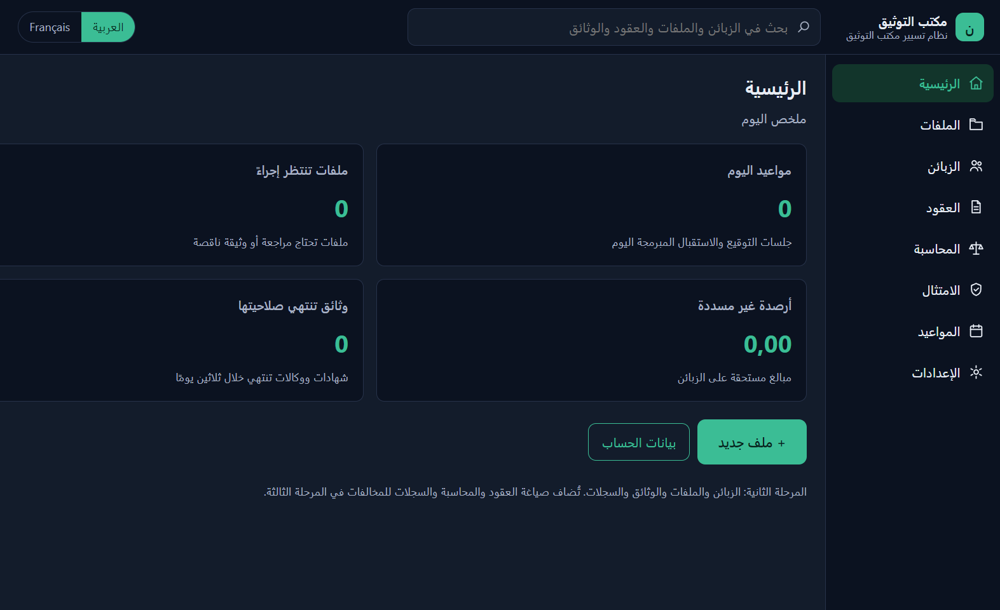
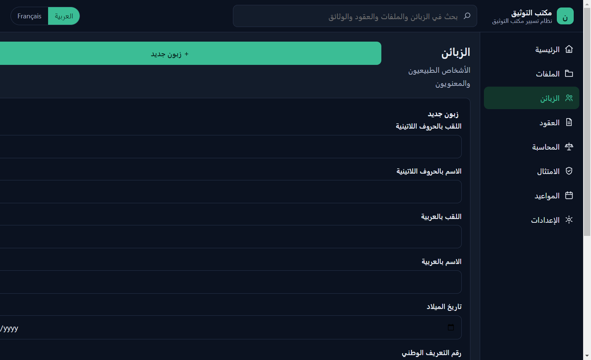
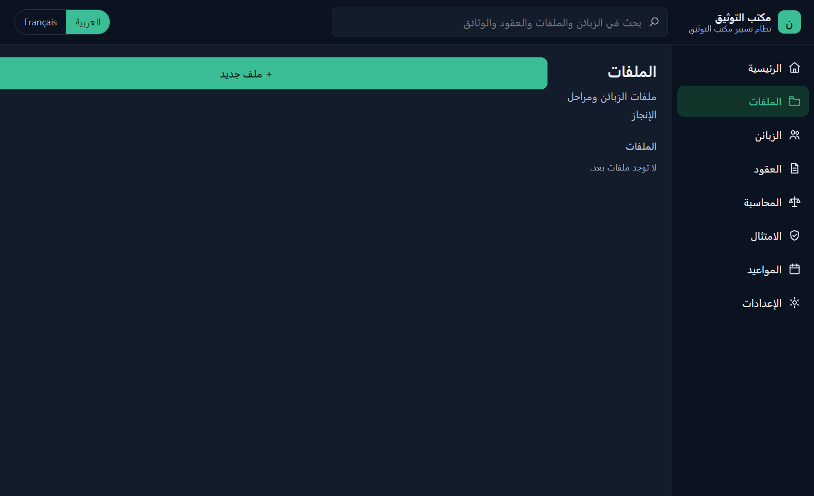

# Notaire DZ, logiciel de gestion pour étude notariale en Algérie

[](LICENSE)
[](#1-installation)
[](#5-mod%C3%A8le-de-s%C3%A9curit%C3%A9)

[English](README.md) · **Français**

Une application de bureau **Windows 10/11, 100 % hors ligne**, pour une étude notariale
algérienne. Clients, dossiers, coffre-fort de documents chiffré, journal d'audit infalsifiable,
sauvegardes chiffrées et interface bilingue arabe / français, sur un seul poste, sans connexion
Internet et sans compte dans le cloud.

Cœur métier en Rust, coque Tauri 2, interface React et TypeScript. Les données sont chiffrées au
niveau applicatif en AES-256-GCM avec une clé maîtresse dérivée par Argon2id : le fichier de base
de données est inutilisable sans la clé de l'étude. Les montants sont des centimes entiers, jamais
des nombres à virgule flottante. L'arabe est la langue principale, le passage au français est
instantané, mise en page de droite à gauche comprise.



| Clients | Dossiers |
|---|---|
|  |  |

**Guide du client :** [`docs/manual/NotaireDZ-Manuel.pdf`](docs/manual/NotaireDZ-Manuel.pdf)
(13 pages, arabe avec résumé français, captures d'écran pour chaque étape).
Version texte pour le personnel : [`USER_GUIDE.md`](USER_GUIDE.md).

---

## 1. Installation

1. Téléchargez **`NotaireDZ-Setup-1.0.1.exe`** depuis la [dernière version](https://github.com/chettouhyacine/notaire-dz/releases/latest).
2. Lancez-le. L'installation est par utilisateur, **aucun mot de passe administrateur** n'est demandé.
3. Ouvrez **Notaire DZ** depuis le raccourci du Bureau ou le menu Démarrer.

Le premier lancement crée l'étude sur la machine et affiche l'écran de connexion avec le compte
`admin` et le mot de passe `admin`, déjà remplis. Changez ce mot de passe dans
**Paramètres → بيانات الحساب** dès que l'étude est configurée.

Un second raccourci, **Notaire DZ (demo)**, ouvre une étude jetable avec des données d'exemple et
sans écran de connexion, pour essayer le logiciel avant de saisir de vrais dossiers.

**Emplacement des données :** `%LOCALAPPDATA%\NotaireDZ\` (`office.sqlite`, `office.salt`,
`office.key`, `vault\`, `backups\`). Le désinstalleur retire le programme et les raccourcis et
laisse ce dossier intact.

> L'installeur n'est pas signé numériquement. Windows peut afficher un avertissement SmartScreen
> sur un autre poste : *Informations complémentaires*, puis *Exécuter quand même*.

## 2. Ce que fait cette version

| Domaine | État |
|---|---|
| Connexion, code de récupération, assistant d'instructions en cinq pages, panneau de compte | Fonctionnel |
| Clients, noms en double écriture, détection des doublons | Fonctionnel |
| Dossiers, listes de contrôle, permissions par dossier | Fonctionnel |
| Coffre-fort de documents chiffré, adaptateur OCR | Fonctionnel (l'OCR exige Tesseract installé) |
| Journal d'audit en ajout seul, chaîné par hachage, vérifiable | Fonctionnel |
| Sauvegardes chiffrées et restauration | Fonctionnel |
| Registres, procès-verbaux, copies certifiées | Cœur prêt, écrans partiellement reliés |
| Rédaction d'actes, tarifs et émoluments, comptabilité, calendrier de conformité, agenda | Absents de cette version : les quatre sections du menu sont des écrans d'attente explicites |
| Langues | Arabe (principal, droite à gauche) et français, changement instantané |
| Mode démonstration | Étude séparée dans `%LOCALAPPDATA%\NotaireDZ-demo`, badge permanent |

Le logiciel assiste le notaire. Il ne décide jamais à sa place : chaque acte, chaque montant et
chaque liste générés restent modifiables et relus avant signature.

## 3. Compiler depuis les sources

Prérequis : **Rust** (1.75 ou plus récent), **Node.js 18 ou plus récent**, et sous Windows le
**runtime WebView2** (déjà présent sur Windows 10 et 11).

```bash
# cœur métier : chiffrement, chaîne d'audit, rôles, moteur de règles, stockage, sauvegarde
cargo test --manifest-path core/Cargo.toml

# interface : vérification des types, tests unitaires, bundle de production
cd app
npm install
npm run verify

# binaire de bureau (release)
cd ../desktop/src-tauri
cargo build --release
```

Le résultat est `desktop/src-tauri/target/release/notairedz-desktop.exe`. L'installeur du dossier
`installer/` enveloppe ce binaire : `Setup.cs` est le lanceur, `install.cmd`, `uninstall.cmd` et
`shortcuts.ps1` réalisent l'installation par utilisateur.

## 4. Utiliser l'étude

| Tâche | Où | Résultat |
|---|---|---|
| Ajouter un client | الزبائن → جديد | fiche créée, recherchable dans les deux écritures |
| Ouvrir un dossier | الملفات → جديد | dossier avec liste de contrôle et accès |
| Déposer un document | Dossier → Documents | fichier chiffré dans le coffre, empreinte enregistrée |
| Vérifier le journal | Paramètres → Audit | chaîne vérifiée, empreinte de tête affichée |
| Sauvegarder | Paramètres → Sauvegarde | fichier `.zip` chiffré dans `backups\` |
| Changer identifiant ou mot de passe | Paramètres → بيانات الحساب | identifiants mis à jour, entrée d'audit écrite |
| Changer de langue | Barre du haut, العربية / Français | interface et sens de lecture |

Les étapes détaillées avec captures sont dans le guide PDF ci-dessus.

## 5. Modèle de sécurité

* **Aucun réseau.** L'application n'ouvre aucune socket, ne charge aucun contenu distant et
  n'envoie aucune télémétrie.
* **Chiffrement au repos.** Les enregistrements sont scellés en AES-256-GCM avant d'atteindre
  SQLite. La clé maîtresse vient d'Argon2id appliqué au fichier de clé de l'étude. Les champs
  recherchables utilisent des index aveugles HMAC, donc la recherche fonctionne sans stocker de
  clair.
* **Identifiants.** Le mot de passe de connexion est haché avec Argon2id. Dans cette version, la
  clé de données se trouve dans `office.key` à côté de la base : le mot de passe verrouille
  l'écran, il ne protège pas seul les fichiers. Chiffrez le disque du poste avec BitLocker et
  gardez les sauvegardes sur un support amovible.
* **Journal d'audit.** Chaque écriture, export, lecture sensible, connexion et changement de règle
  est ajouté avec un maillon haché : supprimer ou modifier une entrée se détecte.
* **Rôles.** Appliqués dans le cœur Rust, pas seulement dans l'interface : notaire, clerc,
  assistant, comptable, avec listes d'accès par dossier et chiffrement de champ pour les numéros
  d'identité, les coordonnées bancaires et les données de lutte contre le blanchiment.
* **Sauvegardes.** Chiffrées, versionnées, vérifiées en intégrité, avec un exercice de restauration
  documenté.

## 6. Architecture

```
core/          crate notaire-core : enveloppe de chiffrement, chaîne d'audit, RBAC, moteur de
               règles, arithmétique monétaire, stockage SQLite avec migrations vérifiées, backup
desktop/       coque Tauri 2 : fenêtre, commandes, dossier de données, mode démo
app/           React 18 + TypeScript (Vite) : écrans, i18n (ar, fr), styles
docs/          dossier de conception : architecture, modèle de données, modèle de menace,
               registre juridique, moteur de règles, maquettes, stratégie de test, plan, DPIA
docs/manual/   guide du client : source HTML, PDF, captures d'écran
installer/     sources de l'installeur par utilisateur
scripts/       outillage de compilation, icônes, préparation des captures
```

L'interface ne touche jamais au système de fichiers ni à la base. Elle appelle des commandes Tauri,
qui appellent le cœur Rust, seul détenteur de la clé de chiffrement et de chaque règle.

```
office.sqlite    enregistrements chiffrés, chaîne d'audit, journal des migrations
office.salt      sel de la dérivation de clé
office.key       clé de l'appareil qui ouvre l'étude
vault/           charges utiles des documents, chiffrées
backups/         sauvegardes chiffrées
```

## 7. La loi est une donnée, jamais du code

Chaque taux, délai, clause obligatoire et procédure vit dans une **table de règles versionnée**
avec une source, un relecteur, une date de relecture et une date d'effet. Les entrées commencent
marquées `[VERIFY]` et le restent visiblement jusqu'à validation par un notaire ou un juriste. Le
logiciel n'invente aucune règle de droit, et un changement de loi est une mise à jour de données
avec entrée d'audit, pas une nouvelle version du programme.

Rien dans ce dépôt ne constitue un avis juridique. Voir
[`docs/04-legal-assumptions-register.md`](docs/04-legal-assumptions-register.md).

## 8. Limites connues

* Contrats, comptabilité, calendrier de conformité et agenda sont des écrans d'attente dans cette
  version : ils affichent qu'ils arrivent.
* L'OCR exige le binaire Tesseract installé séparément ; sans lui, les documents sont stockés et
  indexés à la main.
* La fenêtre est prévue pour 1366 × 768 et plus.
* Un poste, une étude. Aucune synchronisation entre ordinateurs ; déplacer l'étude signifie
  restaurer une sauvegarde.

## 9. Vérifications effectuées

* `cargo test` : **92 tests unitaires** (chiffrement, chaîne d'audit, rôles, monnaie, moteur de
  règles, migrations, sauvegarde, récupération, clé d'appareil) et **7 tests d'intégration**
  (parcours de l'étude, sécurité du stockage).
* `npm run verify` : types sans erreur, **35 tests d'interface**, bundle de production construit.
* Installeur : construit, installé et lancé sous Windows 11, fichiers et version vérifiés contre le
  build, entrée de désinstallation et raccourcis contrôlés.
* Manuel : PDF de 13 pages généré depuis la source HTML avec de vraies captures.

## 10. Licence

MIT. Voir [LICENSE](LICENSE).
