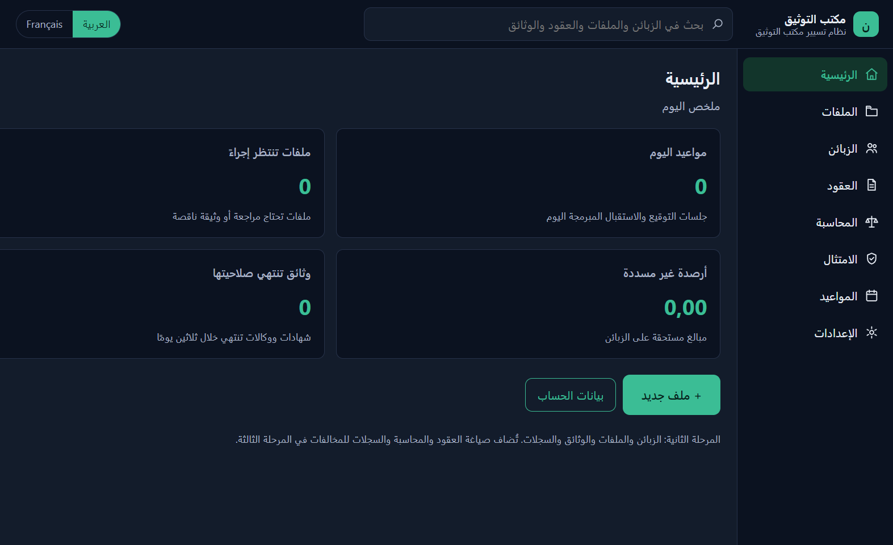
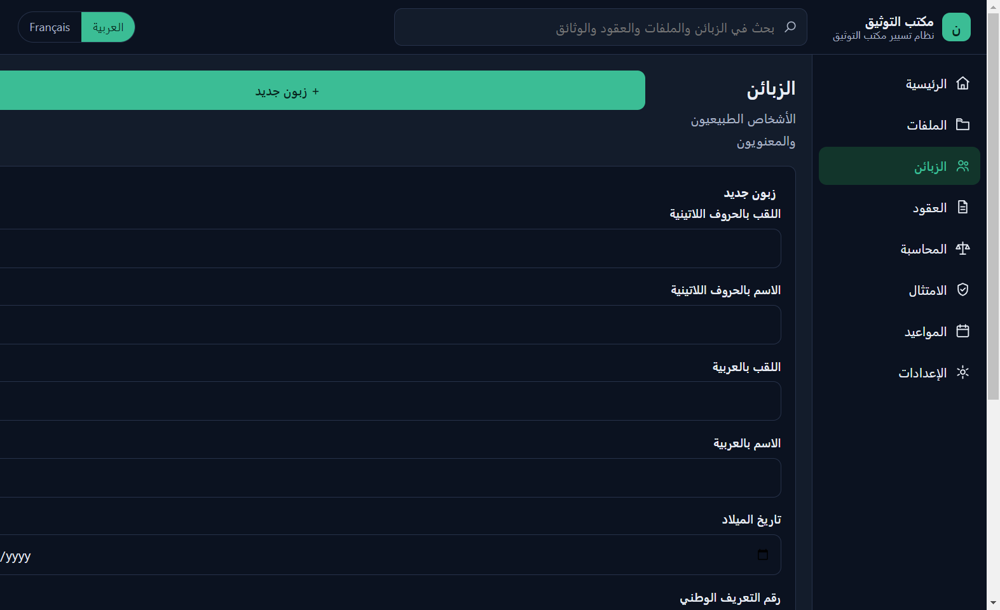
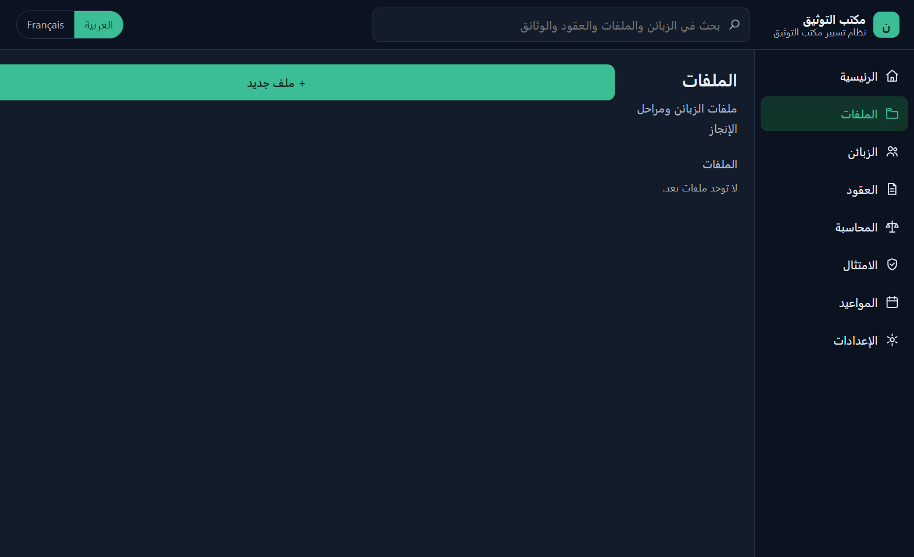

# Notaire DZ: notarial practice software for Algeria

[](LICENSE)
[](#1-installation)
[](#5-security-model)

**English** · [Français](README.fr.md)

A **100 % offline Windows 10/11 desktop application** for an Algerian notary office
(*étude notariale*). Clients, case files, an encrypted document vault, a tamper-evident audit
trail, encrypted backups and a bilingual Arabic / French interface, all on one machine with no
Internet connection and no cloud account.

Rust domain core + Tauri 2 shell + React and TypeScript interface. Data is encrypted at the
application layer with AES-256-GCM under an Argon2id-derived master key, so the database file is
useless without the office key. Amounts are integer centimes, never floating point. Arabic is the
primary language with instant switching to French and back, right to left layout included.



| Clients | Case files |
|---|---|
|  |  |

**Client guide:** [`docs/manual/NotaireDZ-Manuel.pdf`](docs/manual/NotaireDZ-Manuel.pdf)
(13 pages, Arabic with a French summary, screenshots for every step).
A text version for staff is in [`USER_GUIDE.md`](USER_GUIDE.md) (French).

---

## 1. Installation

1. Download **`NotaireDZ-Setup-1.0.1.exe`** from the [latest release](../../releases/latest).
2. Run it. The install is per user, so **no administrator password** is asked.
3. Launch **Notaire DZ** from the desktop shortcut or the Start menu.

The first launch creates the office on the machine and opens on the sign-in screen with the
account `admin` and the password `admin`, both prefilled. Change the password in
**Settings → بيانات الحساب** as soon as the office is set up.

A second shortcut, **Notaire DZ (demo)**, opens a throwaway office with sample data and no sign-in
screen, useful to try the software before entering real records.

**Where the data lives:** `%LOCALAPPDATA%\NotaireDZ\` (`office.sqlite`, `office.salt`,
`office.key`, `vault\`, `backups\`). The uninstaller removes the program and the shortcuts and
leaves that folder untouched.

> The installer is not code signed. Windows may show a SmartScreen warning on another PC:
> *More info*, then *Run anyway*.

## 2. What this version does

| Area | State |
|---|---|
| Sign-in, passphrase recovery code, five page instructions wizard, account panel | Working |
| Clients, with dual-script names and duplicate detection | Working |
| Case files (dossiers), checklists and per-case permissions | Working |
| Encrypted document vault, OCR adapter | Working (OCR needs Tesseract installed) |
| Audit trail: append-only, hash chained, verified on demand | Working |
| Encrypted backups and restore | Working |
| Registers, minutes and certified copies | Core ready, screens partially wired |
| Contracts and deeds drafting, fees and tariffs, accounting, compliance calendar, agenda | Not in this version: the four sidebar sections are explicit placeholders |
| Languages | Arabic (primary, RTL) and French, switched instantly |
| Demo mode | Separate office in `%LOCALAPPDATA%\NotaireDZ-demo`, permanent badge |

The application assists the notary. It never decides in the notary's place: every generated act,
figure or checklist is editable and reviewable before signature.

## 3. Build from source

Requirements: **Rust** (1.75 or newer), **Node.js 18 or newer**, and on Windows the
**WebView2 runtime** (already present on Windows 10 and 11).

```bash
# domain core: crypto, audit chain, roles, rules engine, storage, backup
cargo test --manifest-path core/Cargo.toml

# interface: type check, unit tests, production bundle
cd app
npm install
npm run verify

# desktop binary (release)
cd ../desktop/src-tauri
cargo build --release
```

The result is `desktop/src-tauri/target/release/notairedz-desktop.exe`. The installer in
`installer/` wraps that binary: `Setup.cs` is the launcher (compiled with the .NET Framework
compiler), `install.cmd`, `uninstall.cmd` and `shortcuts.ps1` are the per-user install steps.

## 4. Using the office

| Task | Where | Result |
|---|---|---|
| Add a client | Clients → New | party record, searchable by name in either script |
| Open a case file | Case files → New | dossier with checklist and access list |
| Store a document | Case file → Documents | file encrypted in the vault, hash recorded |
| Check the audit trail | Settings → Audit | chain verified, head hash displayed |
| Back up | Settings → Backup | encrypted `.zip` in `backups\` |
| Change login or password | Settings → بيانات الحساب | credential updated, audit entry written |
| Switch language | Top bar, العربية / Français | whole interface and layout direction |

Detailed steps with screenshots: the client guide PDF above.

## 5. Security model

* **No network.** The application opens no listening socket, loads no remote content and sends no
  telemetry.
* **Encryption at rest.** Records are sealed with AES-256-GCM before they reach SQLite. The master
  key comes from Argon2id over the office key file. Searchable fields use HMAC blind indexes, so
  lookups work without storing plaintext.
* **Credentials.** The sign-in credential is hashed with Argon2id. In this release the data key is
  held in `office.key` next to the database, which means the credential is a lock on the screen,
  not the only protection of the files: anyone who can copy the whole data folder can open the
  office. Keep the machine's disk encrypted with BitLocker, and keep backups on removable media.
* **Audit trail.** Every write, export, sensitive read, sign-in and rule change is appended with a
  hash chained link, so removing or editing an entry is detectable.
* **Roles.** Enforced in the Rust core, not only in the interface: notary, clerk, assistant and
  accountant, plus per-case access lists and field level encryption for national identity numbers,
  bank details and anti money laundering data.
* **Backups.** Encrypted, versioned, integrity checked, with a documented restore drill.

## 6. Architecture

```
core/          notaire-core crate: crypto envelope, audit chain, RBAC, rules engine,
               money arithmetic, SQLite storage with checksummed migrations, backup
desktop/       Tauri 2 shell: window, commands, data directory, demo mode
app/           React 18 + TypeScript (Vite): screens, i18n (ar, fr), styles
docs/          design package: architecture, data model, threat model, legal register,
               rules engine, wireframes, test strategy, phase plan, DPIA
docs/manual/   client guide: manual.html source, PDF, screenshots
installer/     per-user installer sources
scripts/       toolchain helper, icon generation, screenshot preparation
```

The interface never touches the file system or the database. It calls Tauri commands, which call
the Rust core, which owns the encryption key and every rule.

```
office.sqlite    encrypted records, audit chain, migrations ledger
office.salt      salt for the key derivation
office.key       device key that opens the office
vault/           encrypted document payloads
backups/         encrypted backups
```

## 7. The law is data, never code

Every rate, deadline, mandatory clause and procedure lives in a **versioned rule table** with a
source, a reviewer, a review date and an effective date. Entries start marked `[VERIFY]` and stay
visibly marked until a notary or lawyer signs them off. The software does not invent a legal rule,
and a change of law is a data update with an audit entry, not a new release.

Nothing in this repository is legal advice. See
[`docs/04-legal-assumptions-register.md`](docs/04-legal-assumptions-register.md).

## 8. Known limitations

* Contracts, accounting, compliance calendar and agenda are placeholders in this version. They open
  a screen that says so.
* OCR requires the Tesseract binary to be installed separately; without it, documents are stored
  and indexed by hand.
* The window is designed for 1366 × 768 and larger.
* Single machine, single office. There is no synchronisation between computers; moving an office
  means restoring a backup.

## 9. Verification performed

* `cargo test`: **92 unit tests** (crypto, audit chain, roles, money, rules engine, storage
  migrations, backup, recovery, device key) and **7 integration tests** (office workflow, storage
  security).
* `npm run verify`: type check clean, **35 interface tests**, production bundle built.
* Installer: built, installed and launched on Windows 11, files and version verified against the
  build, uninstall entry and shortcuts checked.
* Manual: 13 page PDF generated from the HTML source with real screenshots.

## 10. License

MIT. See [LICENSE](LICENSE).
