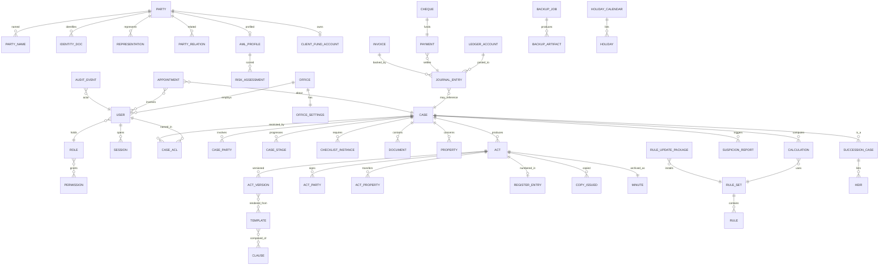

# 02 — Data model

## 1. Conventions

* Primary keys: UUIDv4 stored as `TEXT` (36 chars) — stable across offices, mergeable in LAN mode.
* Timestamps: `INTEGER` Unix milliseconds UTC. Local day boundaries computed in `Africa/Algiers`.
* Money: `INTEGER` centimes. Rates: `INTEGER` numerator / `INTEGER` denominator.
* Encrypted columns carry the `_enc` suffix (`BLOB`) and a companion blind index `_bidx` (`BLOB`)
  when the field is searchable.
* Legal records (`act`, `register_entry`, `audit_event`) are never updated in place and never
  deleted; corrections are new linked rows.

## 2. Entity relationship (Mermaid)

## 3. Table inventory (minimum entities from the brief)

`office`, `office_settings`, `user`, `role`, `permission`, `role_permission`, `session`,
`case_acl`, `party`, `party_name`, `party_relation`, `identity_doc`, `representation`, `case`,
`case_stage`, `checklist_template`, `checklist_instance`, `document`, `document_version`,
`property`, `act`, `act_version`, `act_party`, `act_property`, `clause`, `template`, `register`,
`register_entry`, `minute`, `copy_issued`, `fee_rule_set`, `tax_rule_set` (both via `rule_set` +
`rule`), `calculation`, `ledger_account`, `journal_entry`, `client_fund_account`, `payment`,
`cheque`, `invoice`, `receipt`, `aml_profile`, `risk_assessment`, `suspicion_report`,
`succession_case`, `heir`, `appointment`, `reminder`, `audit_event`, `backup_job`,
`rule_update_package`, `holiday_calendar`, `holiday`, `territorial_unit`, `schema_migration`.

Phase 1 physically creates: `office`, `office_settings`, `user`, `role`, `permission`,
`role_permission`, `session`, `audit_event`, `rule_set`, `rule`, `calculation`, `schema_migration`,
`app_setting`. Later phases add tables in their own migrations; nothing is created empty "for later"
so a partial schema can never be mistaken for a complete one.

## 4. Key indexes

| Table | Index | Purpose |
|---|---|---|
| `party_name` | `(bidx_surname)`, `(bidx_given)` | encrypted duplicate detection / search |
| `case` | `(stage, due_at)`, `(opened_at)` | Home cards, SLA alerts |
| `case_acl` | `(user_id, case_id)` unique | fast permission filter |
| `act` | `(register_id, number)` unique | gap-free numbering |
| `register_entry` | `(register_id, seq)` unique | immutability witness |
| `journal_entry` | `(account_id, posted_at)`, `(case_id)` | trial balance, case cost view |
| `audit_event` | `(seq)` unique, `(occurred_at)`, `(actor_id)` | chain verification, daily head |
| `document` | `(case_id)`, `(sha256)` | case view, duplicate/tamper detection |
| `rule` | `(rule_set_id, code)` | deterministic lookup |
| `appointment` | `(starts_at)`, `(room_id)` | agenda conflict detection |

## 5. Encryption boundaries

| Data | At rest | Search |
|---|---|---|
| Party names, birth data, address, contact, profession, nationality | field ciphertext | blind index (HMAC of NFKC + Arabic-normalised form) |
| NIN / national ID, passport, bank account, cheque details | field ciphertext | exact-match blind index only |
| AML answers, risk notes, suspicion reports | field ciphertext + extra ACL | not searchable (deliberate) |
| Document contents | AES-256-GCM per file, per-document key | FTS index built on decrypted text at query time, never persisted plaintext |
| Act body / clauses | field ciphertext | not searchable |
| IDs, timestamps, stage codes, amounts, rule versions, register numbers | plaintext | indexed |
| Audit log | append-only rows, HMAC-chained | `(seq)` |

Field values are encrypted with the record's data key; the data key is wrapped by the office master
key. Losing the master key means losing the data — by design. Two envelopes around that key make a
lost passphrase survivable: `user_key_wrap` seals the master key under each user's passphrase-derived
key, and `recovery_escrow` seals it under the one-time recovery code issued at setup. Losing both the
passphrase and the code means the office cannot be opened: there is no server-side copy, and the
Shamir-split key sharing from the original design is not implemented (see §8).

## 6. Migration plan

1. Migrations are numbered SQL files embedded in the binary at `core/src/migrations/NNNN_*.sql`.
2. At open, each applied migration's SHA-256 is compared with the recorded checksum; a mismatch
   aborts startup with a clear message (no silent repair).
3. Every migration runs inside a transaction; `schema_migration` records id, checksum, applied_at.
4. Destructive changes require a pre-migration backup, taken automatically and verified before the
   transaction commits.
5. Forward-only. Rollback is by restoring the pre-migration backup, which keeps the legal record
   auditable.
6. Tests: apply all migrations to an empty DB, apply twice (idempotent refusal), and apply to a
   fixture DB from the previous release.

## 7. Numbering and immutability

* `register` holds `series_prefix`, `next_seq`, `year`, `office_id`.
* A number is allocated in the same transaction that finalises the act and inserts the
  `register_entry`; the unique `(register_id, seq)` constraint makes double allocation impossible.
* Finalised acts are locked: only marginal mentions (new `act_version` rows linked by
  `amends_act_id`) with a recorded justification, permission `act.amend_finalised` and an audit
  entry.

## 8. Recovery envelopes (implemented)

| Table | Holds | Opened with |
|---|---|---|
| `user_key_wrap` | the master key sealed under a passphrase-derived key (own salt, own Argon2id parameters) | the user's passphrase |
| `recovery_escrow` | the master key sealed under a key derived from a 120-bit recovery code | the printed code |

* Setup generates a code (six groups of four Crockford base32 symbols) and shows it exactly once,
  before the office opens. Only the sealed master key is stored; the code is never written down by
  the software.
* A reset unwraps the master key with the code, re-hashes the password, replaces the passphrase wrap
  and issues a **new** code that replaces the old escrow (the used code stops working). The master
  key itself never changes, so every record, document key and audit entry stays valid. The reset is
  audited as `auth.passphrase_reset`.
* The code is 120 bits of randomness, so its wrapping key uses a fast PRF (HMAC-SHA-256) rather than
  Argon2id, which is for human-chosen secrets. There is no online guessing oracle; the office file is
  local, and an attacker with the file already has the wrapped blob.
* An office created before these tables existed reports `recovery_available = false` and can only be
  opened with its passphrase; sign-in falls back to the original derive-from-passphrase path, and the
  first successful open applies the new migration.
